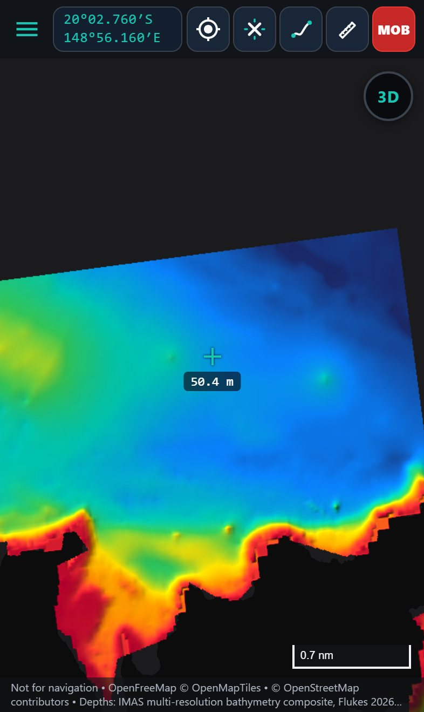
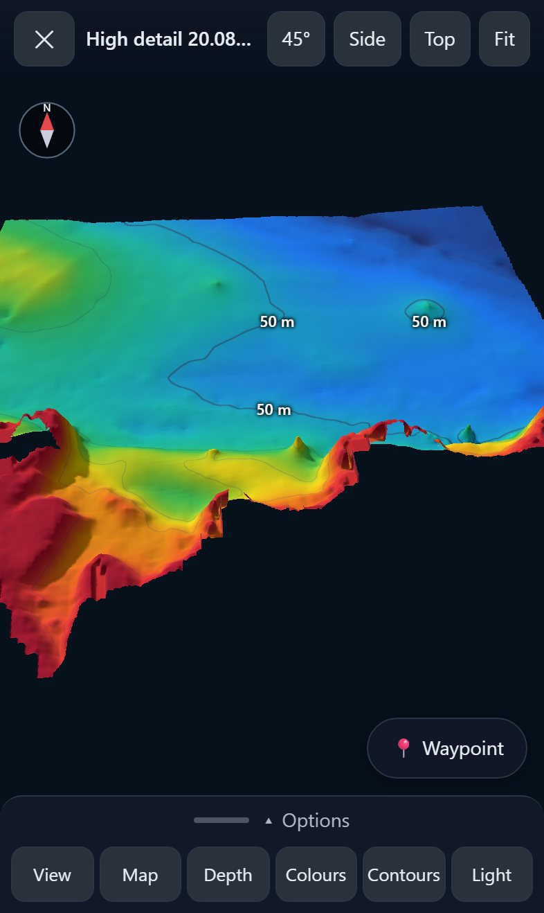
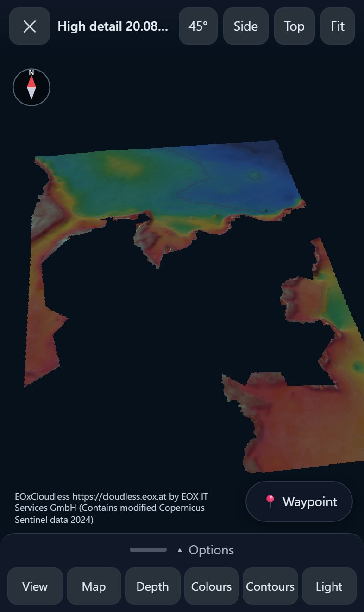
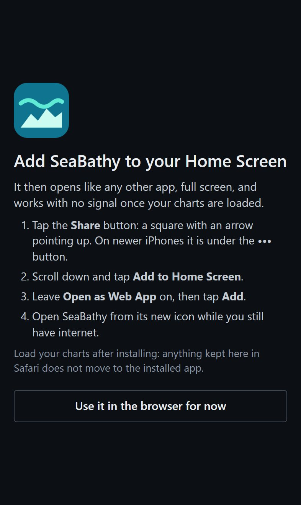
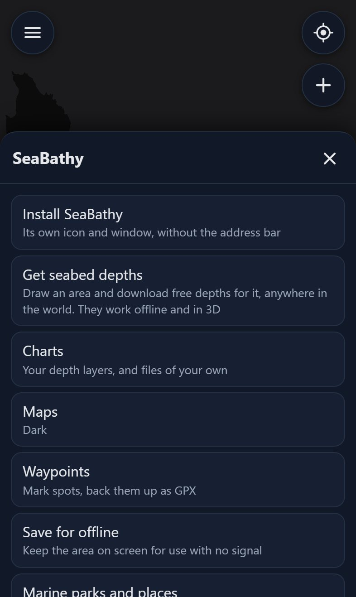
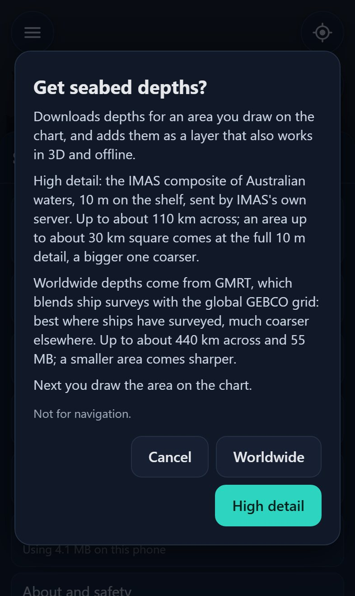
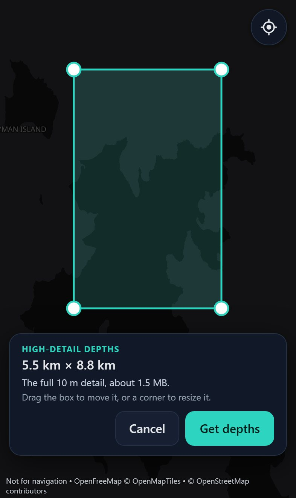
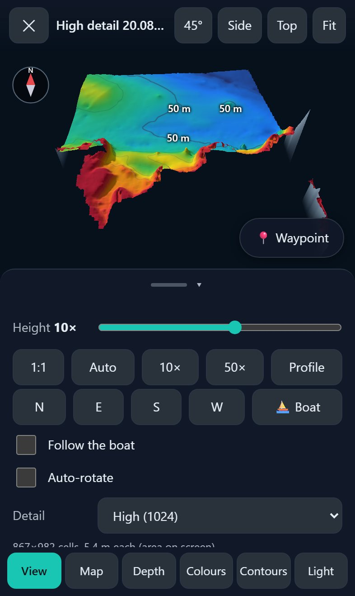
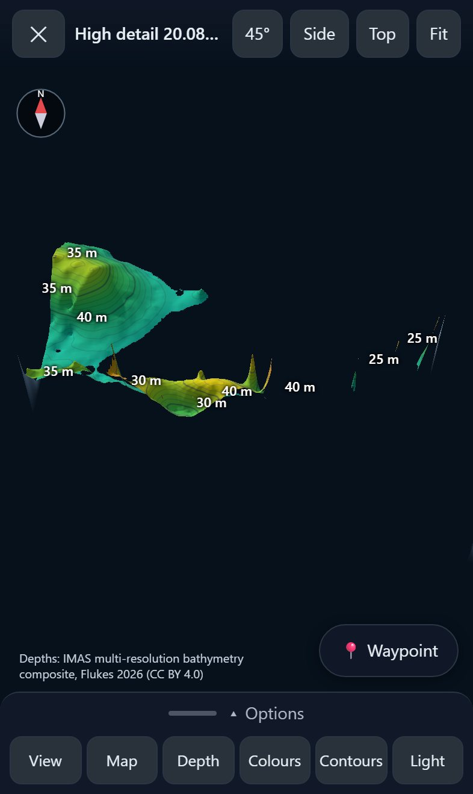
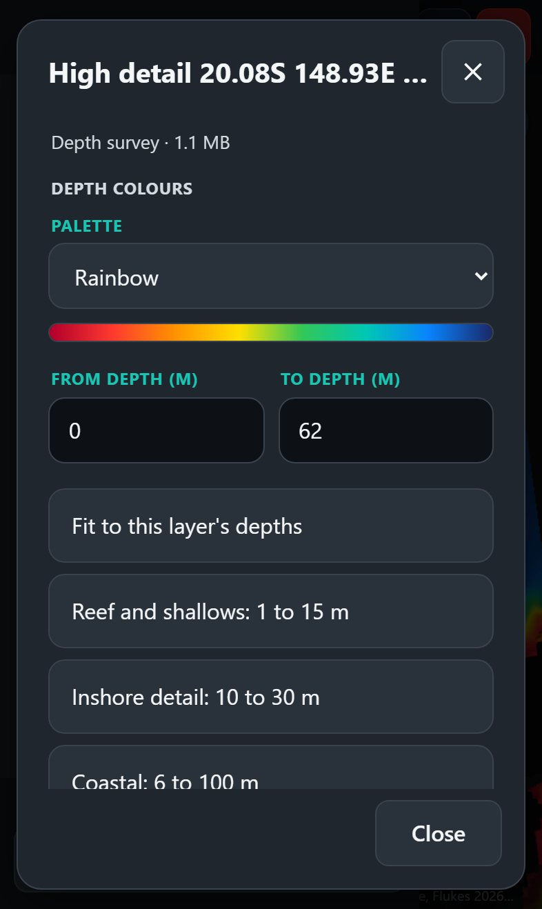

# SeaBathy web app


**See what's under the boat, on an iPhone.** Download free seabed depths, fly over them in 3D,
and take them out with no signal. It runs in the browser and installs from Safari to the Home
Screen, so it needs no App Store. It also works on Android and on a computer.

**Open it: [app.seabathy.com](https://app.seabathy.com)**

| The chart | The seabed in 3D | Satellite on the seabed |
|---|---|---|
|  |  |  |

> **Not for navigation.** SeaBathy is not a nautical chart and must not be used for navigation.
> Its data comes from public sources and from the files you load, and can be wrong or out of
> date. Use official charts and proper navigation equipment. See the
> [terms of use](https://seabathy.com/terms).

This is the web version of [SeaBathy](https://seabathy.com). It has the core of the Android
app: depth download, the 3D seabed, depth colours, satellite, waypoints and GPS. The Android
and Windows apps do more (tides, sea conditions, routes, tracks, anchor alarm).

## Contents

- [Install](#install)
- [Get depths](#get-depths)
- [The seabed in 3D](#the-seabed-in-3d)
- [With no signal](#with-no-signal)
- [What it does](#what-it-does)
- [What an iPhone web app can't do](#what-an-iphone-web-app-cant-do)
- [Storage on the phone](#storage-on-the-phone)
- [Updates](#updates)
- [Your own files](#your-own-files)
- [Publishing the app](#publishing-the-app)
- [Development and tests](#development-and-tests)
- [Privacy](#privacy)
- [Credits and licences](#credits-and-licences)

## Install

 

**iPhone or iPad** (iOS 15.2 or newer):

1. Open **[app.seabathy.com](https://app.seabathy.com)** in **Safari**.
2. Tap the **Share** button (a square with an arrow pointing up). On newer iPhones it is under
   the **•••** button.
3. Scroll down and tap **Add to Home Screen**.
4. Leave **Open as Web App** on, then tap **Add**.
5. Open SeaBathy from its new icon while you still have internet. It saves itself on the phone
   the first time, and after that it opens with no signal.

Install first, then get your depths. Safari and the installed app keep their data apart, so
anything you add in Safari does not appear in the installed app.

**Android:** open [app.seabathy.com](https://app.seabathy.com) in Chrome and choose **Install
app**.
**Computer:** open it in any current browser; Chrome and Edge can install it too.

## Get depths

 

1. Move the chart to the water you want.
2. Menu (☰) → **Get seabed depths**, and choose which depths.
3. **Draw a box** over the area: drag a finger across the chart. Drag the box to move it, or a
   corner to resize it; two fingers still move and zoom the chart. The bar shows the box's size
   and what the download will be.
4. Tap **Get depths**. They arrive as a coloured layer and are kept on the phone. From then on
   they work with no signal.

Nothing is downloaded until you have drawn the box and tapped Get depths.

There are two kinds:

- **High detail, in Australian waters.** The IMAS multi-resolution bathymetry composite, with
  10 m detail on the continental shelf. The box you draw is cut out and sent by IMAS's own
  map server. A box up to about 30 km square comes at the full 10 m; a bigger one, up to
  110 km, comes coarser, so draw a small box for the spot that matters.
- **Worldwide.** GMRT, a free model of the whole ocean built from ship surveys. It is sharpest
  where ships have surveyed and much coarser elsewhere. One download holds up to about 440 km
  across and 55 MB.

The high-detail depths rely on a public IMAS server that this project does not run. If IMAS
changes it, **High detail** stops working until the app is updated; depths already on the
phone and the worldwide depths are not affected.

## The seabed in 3D

 

Tap **3D** on the chart while depths are on screen (or **See it in 3D** on a depth layer).
The viewer is the Android app's own:

- One finger rotates, two fingers pan and zoom, double-tap flies in. Tap for the depth and slope.
- **View:** height from true scale (1:1) to 100×, camera presets, a depth profile between two
  taps, the boat from GPS.
- **Depth:** show just a depth band, such as 10 to 30 m, and **Isolate & zoom** to reload that
  band at full detail. Depths are typed as on a chart: `-30` to `-10`.
- **Colours:** palettes and your own colour range, or colour by slope to find ledges and
  drop-offs.
- **Map:** the satellite picture laid on the seabed, with a blend slider, and **Save this area
  offline**.
- **Contours** with depth labels, and **Light** for the sun, shadows and the sea surface.

Where the area takes in land, 3D opens on the water alone; the Depth tab brings the land back.

## With no signal

Once you have what you want, the app needs no internet:

- **The app itself** is kept on the phone after its first start.
- **Depths** you downloaded, and files you loaded, are kept on the phone, on the chart and in 3D.
- **The satellite picture** works for the areas you saved with **Save for offline**.
- **GPS** comes from the phone, not the internet, so the boat shows on the chart and in 3D.
- **Waypoints** and GPX files are kept on the phone.

Only these need a connection: downloading new depths, the street and topographic basemaps,
satellite outside the areas you saved, and looking for a newer version of the app. With no
signal the chart is your depths and saved satellite on a plain background.

## What it does

- **Free depths,** downloaded in the app and kept on the phone: high detail in Australian
  waters, and the whole world at coarser detail.
- **3D seabed** of any depth layer, with everything listed above.
- **Depth colours** on the chart: seven palettes, your own depth range, ready-made ranges
  (reef, inshore, coastal, offshore) and relief shading. The depth at the crosshair.

  
- **Basemaps:** dark, street map, OpenStreetMap, OpenTopoMap, USGS imagery, your own tile link
  with its credit, or none.
- **Satellite picture** over the chart with an opacity slider, and savable for offline use.
- **Waypoints:** add at the crosshair, by holding a finger on the chart, or by tapping the
  seabed in 3D; name, note, colour and symbol; saved on the phone.
- **GPX in and out,** to back up waypoints and to move them between SeaBathy, a plotter and
  other apps.
- **GPS:** the boat on the chart and in 3D, with speed, course and accuracy, and a follow mode.
- **Your own files:** GeoTIFF depth surveys and PMTiles charts.
- **Storage:** how much the app is using, and a delete button for every layer and saved area.
- **Updates** by itself or after a tap, as you choose.

## What an iPhone web app can't do

- **No GPS with the screen locked.** The position stops when the phone locks or another app is
  in front, so there is no track recording in a pocket and no overnight anchor alarm.
- **The phone may ask for location permission again** on later launches.
- **Smaller limits than the Android app.** One high-detail download holds about 30 km square
  at the full 10 m, and the 3D view holds about a million cells, which a phone browser draws
  comfortably.
- **Installing is by hand,** from Safari. There is no App Store listing.

## Storage on the phone

Everything is kept inside the app on the phone: depth layers and charts in its private file
storage, waypoints, settings and saved map tiles in its database. An iPhone lets an installed
web app use up to about 60% of the phone's storage.

- The app asks the phone to keep its data. iOS decides, and is more likely to agree for an app
  on the Home Screen. **Storage** in the menu shows the answer.
- Without that promise, iOS may clear the data if the phone runs very short of space.
- Removing the app from the Home Screen deletes its data.

Downloaded depths can always be downloaded again. Export your waypoints as GPX now and then.

## Updates

When the phone is online, the app looks at its own web address for a newer version and
downloads it in the background. On the first start it asks which you want:

- **Automatic:** the new version is used the next time you open the app. It never switches
  while you are in the middle of something.
- **Ask me first:** a bar at the top says the version is ready, and nothing changes until you
  tap it.

Change it at any time under Menu → **About and safety** → **Updates**, where **Check for an
update** also looks straight away. Depths, charts and waypoints stay through every update.
Looking for an update sends nothing about you or the phone.

## Your own files

Copy the file to the phone's **Files** app, then menu → **Charts** → **Load a file from this
phone**. It is copied into the app, so it needs free space of about twice its size while it
loads.

| File | What it is |
|---|---|
| `.tif` | A GeoTIFF depth survey, in longitude and latitude or in a projection such as UTM or MGA. Works in 3D |
| `.pmtiles` | A chart pack: depth shapes, contour lines or chart pictures |

Depth shapes and contours are coloured by a number on each shape. The app looks for a field
called `depth`, `contour`, `elevation` or similar, and works out whether depths are written as
positive numbers. If it picks the wrong one, choose the field under the chart's settings.

An MBTiles file must be converted first, on a computer, with the free
[`pmtiles` tool](https://github.com/protomaps/go-pmtiles/releases):

```bash
pmtiles convert chart.mbtiles chart.pmtiles
```

A PMTiles chart can also be read straight from a web address. The server must use HTTPS,
answer part-file (range) requests and allow other sites to read it (CORS).

## Publishing the app

The app at app.seabathy.com is this repository's `main` branch, served by GitHub Pages; the
`CNAME` file holds the address. The app is plain files with no build step, so a copy of your
own works on any static host. On GitHub Pages:

1. Push this repository to GitHub.
2. **Settings → Pages → Build and deployment → Deploy from a branch**, branch `main`, folder
   `/ (root)`.
3. Wait a minute, then open the address Pages gives you.

**Choose the final address before anyone uses it.** A phone ties saved depths and waypoints to
the app's web address. If the address changes later (a new domain, a renamed repository),
everyone starts again with an empty app.

**When you change any file,** raise `VERSION` in `sw.js`, `js/install.js` and `package.json`.
That is what makes phones fetch the new copy. Publishing the changed files is the whole
release: each phone finds the new version by itself the next time it is online.

## Development and tests

```bash
npm install
npx playwright install webkit chromium
npm test
```

`npm test` serves the app over HTTPS on this computer and drives it in WebKit (Safari's
engine) set up as an iPhone: first start, offline reload, drawing the download area by finger,
both depth downloads, the 3D view,
GeoTIFF surveys, a PMTiles chart, waypoints, GPX, GPS, a web chart, saving an area, a restart,
deleting a layer, the licence texts, and an update taken both ways (after a tap, and by itself
at the next start). `ENGINE=chromium npm test` runs the same steps in Chromium. `npm run
serve` just serves the app at `https://localhost:8443/`. The test files are made by the tests
themselves, and their own server stands in for the depth services.

**WebKit on Windows is a cut-down build.** It can't write to private file storage, and with a
profile kept on disk it is very slow and its service worker never finishes installing. So on
Windows the WebKit tests use a private window and leave out three checks: a file copied into
the app's storage, a restart, and deleting a layer. Chromium runs those on Windows. WebKit on
Linux and on a Mac runs every check, and the Playwright container does that from any computer:

```bash
docker run --rm --ipc=host -v "$PWD:/work" -w /work mcr.microsoft.com/playwright:v1.65.1-noble npm test
```

Every push to GitHub also runs the tests in WebKit on a Mac (`.github/workflows/test.yml`).

WebKit on a computer is still not an iPhone. The file picker, the Home Screen install, storage
limits and real GPS can only be checked on a phone.

`node tests/live.mjs` checks the published app at its real address: the certificate, offline
use, a real high-detail download and the 3D view. `node tests/screenshots.mjs` retakes the
pictures in this file. Both need the internet, because they download real depths.

| Folder or file | What's in it |
|---|---|
| `js/` | The app: `app.js` starts it; `seabed.js` downloads depths for the box drawn with `areapicker.js`; `survey.js`, `charts.js` and `depth.js` read and draw them; `terrain.js` runs the 3D view; `updates.js` keeps the app up to date; `basemap.js`, `waypoints.js`, `gps.js`, `offline.js`, `files.js`, `db.js` are what their names say |
| `3d/` | The 3D viewer: the Android app's (`terrain3d-web`), changed only in where it loads three.js from, how it is handed its grid and map tiles, keeping land hidden after a reload, a map credit that wraps instead of being cut short, and the wording of its own-map form |
| `vendor/` | MapLibre GL JS, three.js, PMTiles, geotiff.js and proj4js, as released, with their licences. The two three.js add-ons have their import line pointed at the copy beside them |
| `glyphs/` | Lettering for depth labels, kept with the app so labels work offline |
| `sw.js` | Keeps the app's own files on the phone for offline use |
| `THIRD-PARTY-NOTICES.txt` | The licence of every library inside the app |
| `screenshots/` | The pictures in this file |
| `tests/` | The tests and their small HTTPS server |

## Privacy

SeaBathy has no accounts, ads or analytics, and sends nothing to this project. Your position,
waypoints and depths stay on your phone. The app talks only to:

- **the depth server** when you download depths: GMRT, or IMAS for high detail;
- **the map servers** of the maps you turn on;
- **its own web address,** to fetch itself and to look for a newer version;
- **any web address you add yourself,** for a map or a chart.

Each of those sees what any web request shows: your internet address and, for maps and depths,
the area you asked for. One more request can happen: a survey in an unusual map projection
makes the app ask [epsg.io](https://epsg.io) once for that projection's definition, by its
number.

## Credits and licences

- **Code:** GNU GPL-3.0, see [LICENSE](LICENSE). SeaBathy is free, with no ads and nothing to
  buy.
- **Libraries:** [MapLibre GL JS](https://github.com/maplibre/maplibre-gl-js) and
  [PMTiles](https://github.com/protomaps/PMTiles) (BSD 3-Clause),
  [three.js](https://github.com/mrdoob/three.js),
  [geotiff.js](https://github.com/geotiffjs/geotiff.js) and
  [proj4js](https://github.com/proj4js/proj4js) (MIT). Their licences, and those of everything
  they are built from, are in [THIRD-PARTY-NOTICES.txt](THIRD-PARTY-NOTICES.txt) and
  [`vendor/licenses`](vendor/licenses). Depth labels use Open Sans
  ([licence](glyphs/LICENSE.txt)). All of these can be read inside the app: Menu → About and
  safety → **Licences**.
- **Maps and data** are not part of the app. Each comes from its own server, and its credit is
  shown on the chart while it is shown; a tap on the credit line shows every credit in full.

| Map or data | Credit | Terms |
|---|---|---|
| High-detail depths | Flukes, E. (2026). Multi-resolution bathymetry composite surface for Australian waters (EEZ) [Dataset]. Institute for Marine and Antarctic Studies. https://doi.org/10.25959/Y9VF-V723 | [CC BY 4.0](https://creativecommons.org/licenses/by/4.0/). Not to be used for navigation |
| Worldwide depths | GMRT, the Global Multi-Resolution Topography synthesis: Ryan et al. 2009, doi:10.1029/2008GC002332 | [CC BY 4.0](https://creativecommons.org/licenses/by/4.0/). Not to be used for navigation |
| Dark and street basemaps | OpenFreeMap © OpenMapTiles, © OpenStreetMap contributors | Open data (ODbL). Not saved offline |
| OpenStreetMap | © OpenStreetMap contributors | ODbL. Shown as you look at it only: its tile servers do not allow saving offline, and the app does not offer it |
| OpenTopoMap | Map data: © OpenStreetMap contributors, SRTM. Map style: © OpenTopoMap | CC-BY-SA. Asks for no bulk downloads; not saved offline |
| USGS Imagery | USGS The National Map | US public domain |
| Sentinel-2 satellite | EOxCloudless https://cloudless.eox.at by EOX IT Services GmbH (Contains modified Copernicus Sentinel data 2024) | [CC BY-NC-SA 4.0](https://creativecommons.org/licenses/by-nc-sa/4.0/): non-commercial use, keep the credit. The one map offered for saving offline, at a gentle pace |
| Latest true colour | NASA Global Imagery Browse Services (GIBS), part of NASA's ESDIS | NASA data, credit requested |

The depths are shown resampled and coloured by SeaBathy, and a bigger area comes as a coarser
grid; the data is otherwise as its makers publish it. They do not endorse SeaBathy. Every credit
shows on the chart and in the 3D view while its map or depth layer is shown.

A map you add by your own link, and any file you load, is used under its owner's terms. Add
only a map whose terms allow it, and type the credit its owner asks for.

**The pictures in this file** show depths from the IMAS multi-resolution bathymetry composite
(Flukes 2026, CC BY 4.0), the basemap by OpenFreeMap © OpenMapTiles, © OpenStreetMap
contributors, and the satellite picture EOxCloudless https://cloudless.eox.at by EOX IT
Services GmbH (Contains modified Copernicus Sentinel data 2024).
